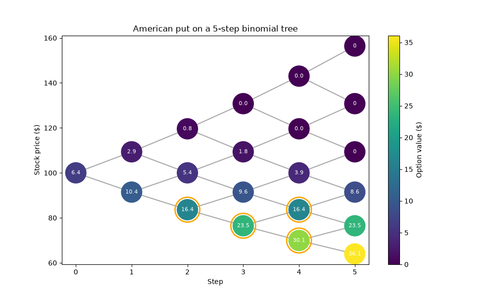
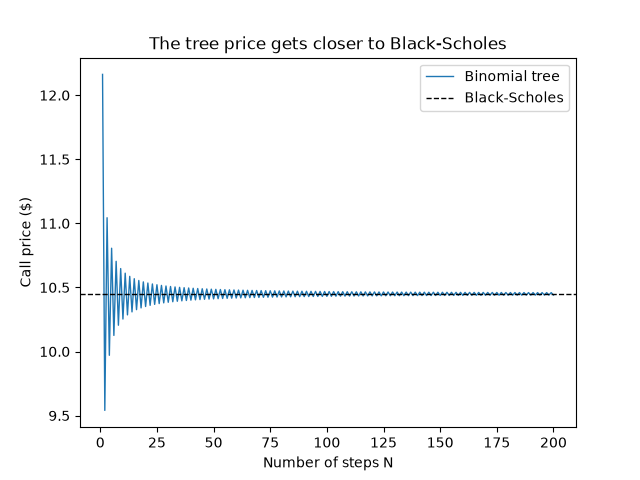
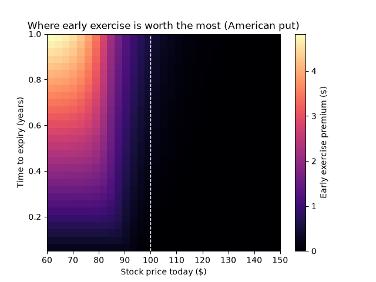

# Binomial Options Pricing Model
Pricing European and American options with a binomial tree in Python, checked against Black-Scholes.

## Ideas behind the Project
A binomial tree that prices stock options by letting the stock go up or down at each step, then working backward from expiry to today's price. It doesn't match real markets perfectly, since it assumes things like volatility and not mappable onto a live market, but it still gives a solid estimate of what an option should be worth, and it can price American options, which Black-Scholes can't.

specifics:
- A binomial tree that prices European and American calls and puts
- A check against Black-Scholes to prove my model works
- Graphs that visualize black-scholes relationship, and where early exercise is worth the most

## Read it:
open "bopm.ipynb"
